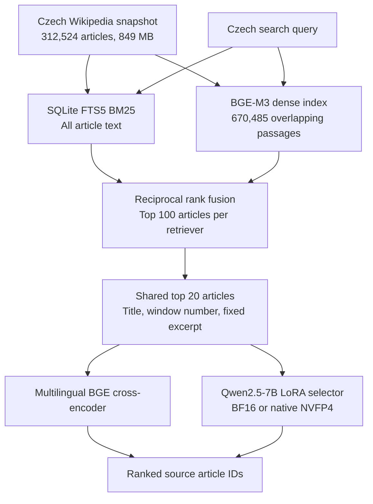

# NVFP4 Structure-Aware Retrieval

**Czech Wikipedia retrieval with Qwen2.5-7B LoRA, BM25, BGE-M3, and native NVIDIA Blackwell FP4 compute.**

A controlled single-GPU experiment over **312,524 articles** and **670,485 passages**. On 600 frozen Czech evaluation questions, the NVFP4-trained selector placed the verified source article first in **94.5%** of queries. The multilingual cross-encoder reached **90.7%**, and the BF16-trained selector reached **90.5%**.

Matched NVFP4 training delivered **1.46x higher throughput** and its selector inference stage ran **1.63x faster** than BF16. The cross-encoder remained about **12x faster** than the NVFP4 selector. Peak allocated training memory was slightly higher with NVFP4.

Technical preview. Source code and supporting experimental artifacts are available on request.

## From a small retrieval pilot to a full archive

The starting question was whether a language model could use document structure, including a table of contents, to retrieve the right evidence more effectively than lexical search. An initial synthetic chat-archive experiment did not establish superiority over BM25, and a hybrid reranker was the strongest comparator.

The next experiment expanded the searchable collection to an entire Czech Wikipedia text snapshot, introduced multilingual retrieval models, trained a 7B selector, and controlled training and inference precision separately. The goal was to measure retrieval quality, compute cost, and memory under a reproducible comparison.

The design takes inspiration from [STAIR and its table-of-contents retrieval approach](https://arxiv.org/abs/2609.03874). Here, retrieval first supplies a compact candidate table of contents. Article titles and numbered passage windows provide the structure. Most original section headings were absent from the text dump, so the window hierarchy is inferred. Scores from this experiment cannot be directly compared with the paper's book-based SearchTome results.

## Retrieval architecture

The reranker and selector receive identical candidates, excerpts, and candidate presentation order. Presentation uses a deterministic permutation independent of relevance. Gold articles are never inserted into evaluation candidates.

The selector scores 20 legal candidate labels using next-token likelihood. It returns an article identifier through that mapping. Answer generation and answer correctness are outside this evaluation.

## Corpus, indexing, and training

| Component | Configuration |
|---|---|
| Corpus | September 2020 Czech Wikipedia text snapshot |
| Collection size | 312,524 articles, 849,287,713 source bytes |
| Dense passages | 670,485 windows, 448 embedding tokens with a 400-token stride |
| Lexical retrieval | SQLite FTS5 BM25, Unicode tokenization, diacritic normalization, Czech query stop words, title/body weights 3:1 |
| Dense retrieval | BGE-M3, normalized 1,024-dimensional CLS embeddings, float16 storage, exact float32 similarity search |
| Fusion | Reciprocal rank fusion with constant 60 |
| Shared evidence | Top 20 articles, each with title, window number, and a query-focused excerpt targeting 128 Qwen tokens |
| Reranker | BGE-reranker-v2-m3 multilingual cross-encoder |
| Selector | Qwen2.5-7B-Instruct with rank-16, alpha-32 LoRA |
| Training | 964 synthetic query/candidate examples, one epoch, 241 optimizer steps |
| Optimizer | AdamW, learning rate 0.0001, microbatch 1, gradient accumulation 4 |

Every article and all body tokens are covered by the indexes. The 7B adapters learn candidate selection from the 964 training examples. Full-corpus indexing and adapter supervision are separate parts of the experiment.

Training-query source articles are disjoint from development and test source articles. The precision comparison holds the base checkpoint, initial adapter weights, prepared token sequences, training order, optimizer settings, and evaluation questions fixed. Both runs use identical padding to multiples of 128 and the final checkpoint after one epoch.

Test prompts average approximately 3,050 tokens. Training uses gradient checkpointing and supervision at the candidate-label position. Projecting only the final hidden state through the vocabulary head avoids materializing a full prompt-length vocabulary tensor.

## Retrieval results

The primary metric is **verified-source Hit@1**: whether the independently checked source article appears first. Each question has one verified relevant source; additional relevant articles may remain unjudged.

| Method | Verified source at rank 1 | Hit@5 | MRR@20 |
|---|---:|---:|---:|
| BM25 | 475/600, 79.2% | 90.7% | 0.842 |
| BGE-M3 dense retrieval | 507/600, 84.5% | 95.0% | 0.894 |
| BM25 + dense fusion | 500/600, 83.3% | 95.0% | 0.888 |
| Hybrid + multilingual reranker | 544/600, 90.7% | 99.0% | 0.945 |
| Base 7B selector, before adapter training | 496/600, 82.7% | 96.8% | 0.889 |
| BF16-trained selector, BF16 inference | 543/600, 90.5% | 97.0% | 0.937 |
| NVFP4-trained selector, NVFP4 inference | **567/600, 94.5%** | 98.3% | **0.963** |

The shared candidate pool contains the verified article for **597/600 questions, or 99.5%**. All three retrieval misses remain failures in the reranker and selector scores.

Paired bootstrap intervals use 10,000 resamples of the frozen questions:

| Hit@1 comparison | Difference | Paired 95% interval |
|---|---:|---:|
| NVFP4 selector versus reranker | +3.83 percentage points | +1.67 to +6.17 |
| NVFP4 selector versus BF16 selector | +4.00 percentage points | +2.17 to +6.00 |
| BF16 selector versus reranker | -0.17 percentage points | -2.83 to +2.50 |

The BF16 comparison with the reranker does not establish a difference in Hit@1. The NVFP4 result provides evidence of an advantage on this particular evaluation. These intervals describe variation across questions; training-seed uncertainty is unmeasured.

## Training precision and inference precision interact

Cross-evaluating both adapters under both compute modes separates the training effect from the inference effect.

| Adapter training | Inference compute | Verified-source Hit@1 |
|---|---|---:|
| BF16 | BF16 | 90.5% |
| BF16 | NVFP4 | 87.8% |
| NVFP4 | BF16 | 94.0% |
| NVFP4 | NVFP4 | 94.5% |

Changing the BF16-trained adapter to NVFP4 inference reduced its score. Training through the NVFP4 compute path produced an adapter that performed well under both modes. The 0.50-point difference between the two inference modes for the NVFP4-trained adapter has a paired 95% interval of -0.67 to +1.67 points.

Quantized-compute adaptation is therefore an important variable in this run. The result does not establish a general accuracy benefit from reducing numerical precision.

## Native FP4 compute and measured cost

The NVFP4 implementation uses NVIDIA Transformer Engine block-scaled matrix multiplication. Recorded CUDA kernel names identify native SM120 E2M1 operations. The recipe disables random Hadamard transforms and stochastic rounding for the tested hardware configuration.

Frozen base projections retain BF16 master weights. LoRA adapters, embeddings, attention, and the output head use higher precision. This precision layout explains why native FP4 arithmetic did not reduce the measured allocated training-memory peak.

| Training compute | Training time | Peak allocated GPU memory |
|---|---:|---:|
| BF16 | 17.70 minutes | 17.17 GiB |
| NVFP4 | 12.12 minutes | 17.48 GiB |

| Ranking stage | Mean latency per query | p95 latency |
|---|---:|---:|
| Multilingual reranker | 15.0 ms | 18.7 ms |
| BF16-trained 7B selector, BF16 compute | 297.4 ms | 316.7 ms |
| NVFP4-trained 7B selector, NVFP4 compute | 182.2 ms | 191.7 ms |

Ranking timings exclude candidate retrieval and model loading. The reranker processes 20 pairs in one batch and includes tokenization; the selector processes one query using prepared tokens. Comparison runs execute sequentially without competing experiment GPU workloads.

The practical tradeoff is explicit: the reranker offers much lower latency and memory use, while the NVFP4-trained selector achieved the highest verified-source Hit@1 in this run.

## Hardware and software

The experiment runs on one consumer NVIDIA Blackwell-class GPU with 32 GB VRAM, a multicore x86-64 CPU, approximately 128 GB host RAM, and Linux. GPU support is verified through actual training, backward passes, adapter reloads, and native FP4 kernel execution.

The tested stack uses PyTorch 2.8.0 with CUDA 12.8, Transformers 4.56.2, PEFT 0.17.1, and NVIDIA Transformer Engine 2.20.2. The CUDA 12.8 runtime works with the host's newer CUDA-capable driver in this configuration. A FastAPI service exposes the retrieval methods and original source articles.

## Evaluation boundaries and next experiments

The 600 test questions and 60 development questions were frozen before training and scoring. They originate from synthetic question generation followed by a separate model's source-based review. Of 665 reviewed drafts, 400 were edited, 261 accepted unchanged, and four rejected; the first 660 approved drafts were selected before the seeded split. Human relevance adjudication remains a next step.

Important boundaries are:

- One training seed and one fixed epoch. Multiple seeds are needed to assess the stability of the precision result.
- Known-source labels rather than exhaustive relevance judgments. Alternative articles can contain equally useful evidence.
- Synthetic queries, noisy topic buckets, and possible base-model pretraining overlap with Wikipedia.
- Inferred article/window structure. A structure-removal ablation is needed to isolate the contribution of structure itself.
- A fixed 2020 archive. Current factual accuracy, incremental updates, abstention, and downstream RAG answer quality require separate evaluation.

The next useful comparisons are human-written Czech queries, adjudicated multiple-source labels, additional training seeds, and matched structure ablations. Retrieval quality, end-to-end latency, and total device memory should be measured together.

## Evidence available on request

Source code, training and evaluation scripts, frozen questions with source evidence, review decisions, immutable model revisions, checkpoint and index hashes, per-query rankings, precision recipes, native CUDA kernel records, failure logs, and machine-readable measurements are available on request.

## Technical references

- [STAIR: Structure Aware Information Retriever](https://arxiv.org/abs/2609.03874), the research starting point for table-of-contents-conditioned retrieval.
- [Qwen2.5-7B-Instruct](https://huggingface.co/Qwen/Qwen2.5-7B-Instruct), the selector's base model.
- [BGE-M3](https://huggingface.co/BAAI/bge-m3) and [BGE-reranker-v2-m3](https://huggingface.co/BAAI/bge-reranker-v2-m3), the multilingual embedding and cross-encoder models.
- [NVIDIA Transformer Engine 2.20.2](https://github.com/NVIDIA/TransformerEngine/releases/tag/v2.20.2), the native low-precision compute implementation.
- [NVIDIA: Pushing Intelligence to 4-bit](https://research.nvidia.com/labs/eai/blogs/pushing-intelligence-to-4-bit/), background on NVFP4 and Blackwell low-precision arithmetic.

**Topics:** information retrieval, structure-aware retrieval, generative retrieval, learning to rank, neural reranking, hybrid search, BM25, reciprocal rank fusion, BGE-M3, Czech NLP, multilingual retrieval, Czech Wikipedia, Qwen2.5, 7B LLM, LoRA, PEFT, BF16, FP4, NVFP4, W4A4, E2M1, Blackwell, Tensor Cores, Transformer Engine, CUDA, PyTorch, RAG, retrieval evaluation, quantization-aware adaptation, single-GPU training.
